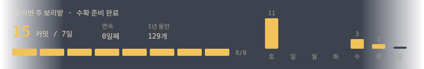

   
  

## 🌾 Projects

<table>
  <tr>
    <td width="50%">
      
    </td>
    <td width="50%">
      <h3><a href="https://github.com/mongyu99/WuwaQuickSwapHelper">WuwaQuickSwapHelper</a></h3>
      
명조(Wuthering Waves)의 퀵스왑 테크닉을 더 쉽고 편하게 쓸 수 있도록 돕는 도구.

      
<code>C#</code>

    </td>
  </tr>
  <tr>
    <td width="50%">
      <h3><a href="https://github.com/mongyu99/WuwaEchoSettingCheck">WuwaEchoSettingCheck</a></h3>
      
스크린샷 한 장만 올리면 에코를 자동으로 인식하고, 고른 캐릭터 기준으로 세팅 점수를 계산.

      
<code>JavaScript</code>

    </td>
    <td width="50%">
      
    </td>
  </tr>
  <!-- 프로젝트 추가: 위 <tr> 블록을 복사해서 이미지/설명 칸 순서만 번갈아 바꾸면 됨 -->
</table>
